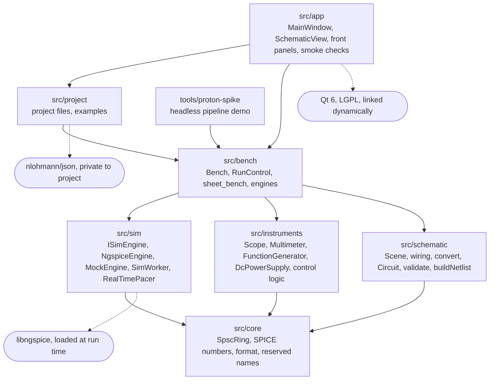
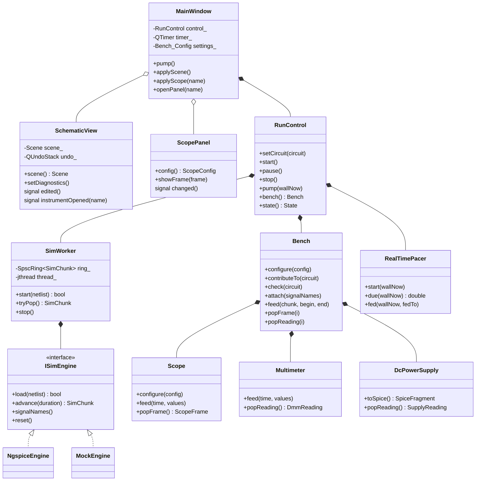
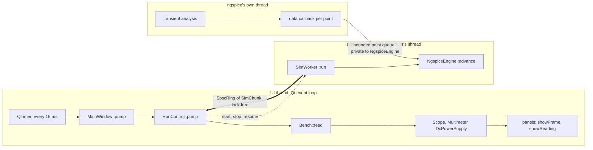
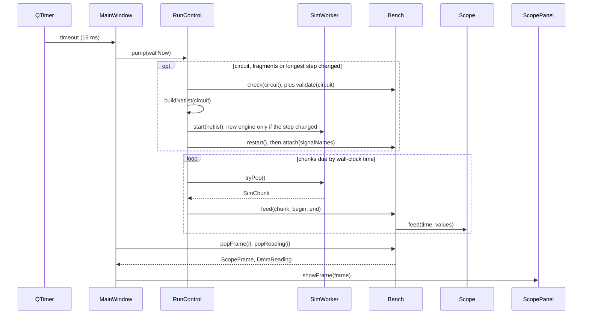
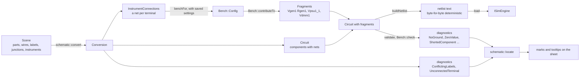
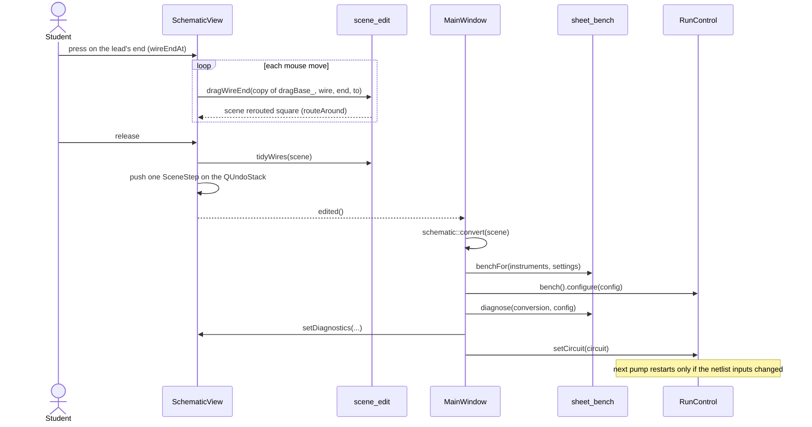
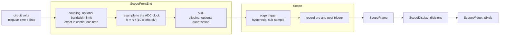
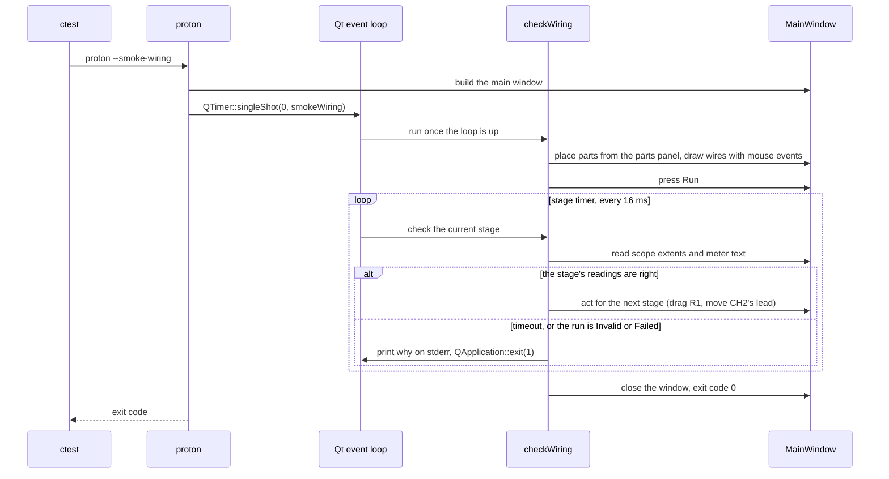

# Proton architecture guide

A guided tour of the code for developers new to Proton: the libraries and what each owns, the
classes that run a circuit and its instruments, the threads, what happens on one UI tick and on one
edit, and how the tests, the app smoke checks among them, prove each layer.

**How it relates to the other docs.** [ARCHITECTURE.md](ARCHITECTURE.md) states the rules and the
reasons for them and stays high level; where the two disagree, it and the class header comments
win. This guide shows how the pieces work together, with diagrams. Update it when a flow drawn here
changes (a class gains or loses a role, a step is added to a tick or an edit) and when a smoke check
is added; not for changes inside a class.

## 1. Layers and rules

Proton is split into small static libraries under `src/`, each depending only on those below it.
Only `src/app` links Qt; everything else builds and is tested on Linux CI machines with no Qt
installed.

*Library dependencies. Solid: links against. Dashed: third party. The app also uses schematic and
instruments types, reached through bench's public headers.*

The hard rules, enforced by CMake and CI:

- No Qt below `src/app`. The Linux jobs check that Qt is absent before building.
- `instruments` never depends on `sim`: instruments consume plain `(time, values)` arrays.
- `schematic` never depends on `instruments`: a generator's SPICE lines arrive as plain `Fragment`
  data.
- Only `SpscRing<SimChunk>` carries data from the simulation thread to the UI thread.
- Same circuit and settings give the same netlist text and the same frames.

Each rule keeps a piece testable on its own. An instrument is checked against an analytic answer
(sine RMS 0.7071, RC corner at -3 dB) by feeding it arrays; a schematic against a golden netlist
without any instrument. The glue between engine, circuit and instruments is logic, so it lives in
the Qt-free `bench`, not in the app.

## 2. What each library owns

| Library | Role | Main types |
|---|---|---|
| `src/core` | Shared basics, no dependencies | `SpscRing<T>`, `parseSpiceNumber`, `format`, `kReservedSource`, `kReservedNode` |
| `src/schematic` | The drawing, its editing, and the circuit it converts to | `Scene`, `PlacedPart`, `Wire`, `NetLabel`; `scene_edit.h` (`moveSelection`, `routeAround`, `dragWireEnd`, ...); `convert` → `Conversion`; `Circuit`, `Component`, `Fragment`; `validate` → `Diagnostic`; `buildNetlist`; `locate` |
| `src/instruments` | Instrument models and the logic of their front-panel controls | `Scope`, `ScopeFrontEnd`, `ScopeFrame`; `Multimeter` → `DmmReading`; `FunctionGenerator` → `SpiceFragment`; `DcPowerSupply` → `SupplyReading`; `Knob`, `Selector`, `DigitEntry`, `SevenSegment`, `ScopeDisplay` |
| `src/sim` | Simulators behind one pull interface, and the worker thread | `ISimEngine`, `NgspiceEngine`, `MockEngine`, `SimWorker`, `SimChunk`, `RealTimePacer` |
| `src/bench` | The glue: instruments wired to the circuit, run control, pacing | `Bench`, `Bench::Config`, `RunControl`, `benchFor`, `remember`, `diagnose`, `ngspiceEngines` |
| `src/project` | Versioned JSON files: the scene and the instruments' settings | `Project`, `Loaded`, `Example`, `read`, `write`, `load`, `save`, `examples` |
| `src/app` (Qt) | The view: draws, forwards input, pumps the bench | `MainWindow`, `StartPage`, `SchematicView`, `PartsPanel`, the panels (`ScopePanel`, `ScopeWidget`, `MultimeterPanel`, `GeneratorPanel`, `SupplyPanel`), `KnobWidget`, `LitButton`, `SegmentDisplay`, `smoke.cpp` |
| `tools/proton-spike` | The whole pipeline headless, on the mock or ngspice; shares its code with the integration test | `spike::pipeline` |

## 3. The classes that run a bench

At run time a handful of objects matter. `MainWindow` owns one `RunControl`, which owns the `Bench`
(the instruments), the `SimWorker` (the engine on its own thread) and the `RealTimePacer`. Panels
and the sheet are views that talk to `MainWindow` through Qt signals.

*Ownership at run time. Filled diamond: owns. Hollow: holds a pointer to a Qt child widget.
Generators are kept only as settings in `Bench::Config`: `contributeTo()` builds a
`FunctionGenerator` to get its SPICE lines.*

Every instrument follows the same contract (ARCHITECTURE.md section 5), which is what lets `Bench`
treat them alike:

- A plain `Config` struct and `configure()`, which like turning a real knob restarts acquisition,
  so state never disagrees with settings.
- `feed(time, values)` in simulation time, never wall-clock time. Points arrive unevenly spaced, as
  SPICE chose them; the instrument takes the signal as linear between points and integrates in
  closed form, so a reading does not depend on step size or chunking.
- Results come out through `pop*()`, never through callbacks into UI code.
- An instrument that acts on the circuit describes itself through `toSpice()` as a
  `SpiceFragment`, which the bench copies into a schematic `Fragment`.

## 4. Threads

Three threads run while a circuit simulates. Instruments live on the UI thread only, so they need
no locks.

*The thick arrow is the only data path into the UI thread. Besides it, only control state
crosses: a stop request and a failure flag.*

- **Backpressure, never dropping.** When the ring is full the worker waits; when ngspice's point
  queue is full its callback blocks, the only way to slow ngspice down. Nothing is lost, and the
  waiting never moves simulation time.
- **Real-time pacing.** `RealTimePacer` says how much simulation time is due at the current
  wall-clock time. It changes *when* instruments are fed, never *what* they see, and it is handed
  the time instead of reading a clock, so it is tested with any time.
- **One ngspice per process.** libngspice keeps global state: `RunControl` destroys the old engine
  before making a new one, and the ngspice tests run one executable per process.

## 5. One UI tick

Everything that moves on screen comes from `MainWindow::pump()`, called by a 16 ms timer.
`RunControl` is declarative: edits only record what should run, and the next pump compares that
with what is running and restarts at most once.

A pump feeds at most one ring of chunks, so it always returns; a chunk only partly due is held for
a later tick. Run states: `Idle`, `Running`, `Paused`, `Invalid` (validate found an error, nothing
runs) and `Failed` (no engine, netlist refused, or the run died). Pausing stops feeding, so
simulation time and every instrument freeze mid-frame; resuming goes on with no restart.

## 6. From drawing to netlist

The student draws a `Scene`: parts, wires, labels, junctions and instruments at grid positions.
`Circuit` is the electrical model, with no positions. Instruments are drawn like parts but enter
the circuit only as a net per terminal and, for sources, as SPICE fragments from the bench.

*The same diagnostics appear in the editor before Run (`bench::diagnose`) and stop the run when
any is an error.*

- **Nets come from the drawing.** A wire joins its two ends; a pin, label or junction lying on a
  wire joins it; wires that only cross do not connect. A net with a ground symbol is `0`, a
  labelled net takes its label, and the rest are `N1`, `N2`, ... by position, so names never depend
  on drawing order.
- **`validate()`** catches beginner mistakes before ngspice turns them into cryptic errors (no
  ground, bad or duplicate designators, bad values, a net with one connection, no DC path to
  ground, a component shorted by a wire across it), each as a sentence for the student.
- **`buildNetlist()`** is pure. Values are normalised, so ngspice never reads a student's spelling;
  the engine adds the analysis line.

## 7. One edit on the sheet

The editor's logic is in `schematic/scene_edit.h` and `wiring.cpp`, Qt-free and unit tested.
`SchematicView` turns mouse events into those calls, keeps undo and emits `edited()`. Here a
student drags the end of a scope lead to another net:

*A drag is previewed by applying the edit again to the scene as it was when the drag began, so the
preview never accumulates rerouting.*

What a change costs while the circuit runs:

| Change | Path | Effect on the run |
|---|---|---|
| Scope V/div, trigger level, coupling | `ScopePanel::changed` → `Bench::configure` | That scope restarts acquisition; the simulation goes on |
| Scope time/div | same | Restart from t = 0 only if it changes the engine's longest step |
| Generator frequency, supply voltage | its fragment changes | Restart from t = 0 (decision D3, ADR 0005), on screen in tens of ms |
| Probe moved to another existing net | `Bench::attach` again | No restart |
| Part, wire or value change | new `Circuit` | Restart from t = 0 |
| Wire moved without changing nets | same circuit | Nothing |

## 8. Inside the scope

The oscilloscope's stages follow a real instrument's order: the analog front end acts on the
continuous signal before sampling, so a signal above Nyquist aliases as on hardware.

*Quantisation and the bandwidth limit default to off: a sample is the simulated voltage at its
time. Auto mode times out on simulation time.*

The same split runs through every panel: `instruments::Knob`, `Selector`, `DigitEntry`,
`SevenSegment` and `ScopeDisplay` hold the logic and geometry and are unit tested; `KnobWidget`,
`SegmentDisplay` and `ScopeWidget` only draw them and turn wheel, key and drag input into clicks.

## 9. The schematic editor

`SchematicView` is a `QGraphicsView` with a single painted item over its own scene model: the
Qt-free `Scene` stays the only model, and every edit is a whole-scene step on a `QUndoStack`.

- **Tools.** Select, which also wires (press on a pin to draw; drag a segment or an end to move
  it), Wire, Label, Junction, and Place for a part or instrument chosen in `PartsPanel`.
- **Routing.** `routeAround()` is an A* search on the grid that costs bends and steps near
  symbols. It never bends on a wire, runs along one, or passes over a pin, label or junction, so a
  route never changes what is connected, and it goes through a symbol only when there is no other
  way.
- **Moves keep nets.** `moveSelection()`, `rotateSelection()` and `dragSegment()` route every
  attached wire chain again, from where its end is now to where the chain first meets something
  else. Tests check that the nets are unchanged and every wire is horizontal or vertical.
- **Diagnostics on the sheet.** `locate()` maps each diagnostic to the parts, wires, labels and
  pins it is about; the view marks them and shows the message as a tooltip.

## 10. Project files

A project is versioned JSON written by `src/project`: the scene with its instruments, and each
instrument's settings. Nets are not stored, since the drawing gives them. A file of an earlier
format is migrated on reading, one version at a time; a later one is refused. The examples in
`examples/` are ordinary project files, copied next to the app and listed on the start page.

Settings survive edits through `sheet_bench`: `benchFor()` builds a fresh `Bench::Config` from the
instruments on the sheet, each taking its saved settings by name, and `remember()` keeps the
settings of deleted instruments, so undo brings them back as they were.

## 11. How it is tested

Most checks are unit tests below the UI, where logic is checked against exact answers. The harness
is `tests/support` (`TEST`, `CHECK`, `CHECK_EQ`, `CHECK_NEAR`), with no external framework.

| Kind | ctest names | What it proves |
|---|---|---|
| Unit, per library | `core`, `schematic`, `instruments`, `sim`, `bench`, `project` | Analytic answers (-3 dB corner, 0.7071 RMS, exact LSB steps), golden netlists byte for byte, wiring keeps nets, run control restarts once per change |
| ngspice, one per process | `ngspice_dll`, `ngspice_engine`, `ngspice_reload`, `ngspice_soak`, `examples_ngspice` | The real simulator loads, runs, recovers from fatal errors, survives long runs, and every example simulates |
| Integration | `integration`, `integration_ngspice`, `proton_spike_runs`, `proton_spike_runs_ngspice` | Circuit → netlist → worker thread → scope and meter, on the same pipeline code as `proton-spike` |
| Measurements | `ngspice_validation`, `ngspice_latency` | ngspice against analytic answers; prints the numbers the ADRs record |
| Repository | `spdx_headers`, `spdx_headers_detects_missing`, `support`, `support_failure_report` | Every source file has the SPDX line; the harness reports failures |
| App smoke checks | `app_*` | The UI is wired to the logic correctly (section 12) |

CI (`.github/workflows/ci.yml`) runs on every push to main and every pull request:

| Job | Builds | Runs |
|---|---|---|
| `windows-msvc-debug`, `windows-msvc-release` | Everything, with Qt and the ngspice DLL | Every test, the app smoke checks included |
| `linux-clang-asan` | The Qt-free libraries, ngspice built from source | Unit, ngspice and integration tests under ASan and UBSan |
| `linux-clang-tsan` | same | The same under TSan, which is what checks the threads |

All jobs configure with `-DPROTON_WARNINGS_AS_ERRORS=ON` and require ngspice, so none can silently
skip the simulator tests.

## 12. The smoke checks

Unit tests prove the logic. They cannot prove that a knob widget reaches `Scope::configure`, that a
panel draws what the scope produced, or that ngspice runs inside the app's process next to Qt. The
smoke checks close that gap. Each is a mode of the real `proton` executable (`--smoke-wiring` and so
on), registered with ctest as `app_*`: it drives the app with real mouse, wheel and key events,
reads what the panels show, and exits with 0 or 1, saying on stderr what failed.

**Smoke checks check wiring, not logic.** When one fails on a calculation, that calculation belongs
in a unit test below the UI.

*Stages wait on the simulation, not on fixed sleeps, so they pass on slow CI machines and fail fast
with a reason.*

| ctest name | Flag | Task | What it proves | Needs |
|---|---|---|---|---|
| `app_starts` | `--smoke-test` | M2.1 | The app opens its main window and quits cleanly; Qt is deployed next to the executable | Qt |
| `app_undo_redo` | `--smoke-undo` | M4.3 | Every kind of edit undoes back to the empty sheet and redoes to the same scene | Qt |
| `app_editor_diagnostics` | `--smoke-diagnostics` | M4.9 | Each drawing mistake is marked where it is, its message shown on hover | Qt |
| `app_selection` | `--smoke-selection` | M4.10 | Box selection, Shift, Delete, Escape, and every right-click menu entry | Qt |
| `app_project_files` | `--smoke-files` | M4.11 | Save, open, recent files and the start page; a file that is not a project is refused | Qt |
| `app_runs_examples` | `--smoke-examples` | M2.2 | Every example runs from the menu; the divider reads 2.500 V; prints frame rate and paint times | ngspice |
| `app_panel_controls` | `--smoke-panel` | M2.4, M2.5 | Every scope and meter control answers wheel, keys, drag and clicks | ngspice |
| `app_generator_latency` | `--smoke-latency` | M2.6 | One click of the frequency knob reaches the scope's screen in time (ADR 0005) | ngspice |
| `app_draws_by_hand` | `--smoke-editor` | M4.2, M4.4 | Two circuits drawn from the parts panel; two scopes and two meters each read their own nets | ngspice |
| `app_menus_and_toolbars` | `--smoke-menus` | M4.7 | Every menu and toolbar action; Run, Pause, resume without a restart, Stop | ngspice |
| `app_corner_frequency_session` | `--smoke-session` | M4.8 | A student finds the RC corner with the panels: 0.500 V on the meter, a 45 degree lag on the scope | ngspice |
| `app_power_supply` | `--smoke-supply` | M5.1 | A supply into 1 kΩ shows 5.000 V and 0.0050 A; LIMIT lights past the limit | ngspice |
| `app_ammeter` | `--smoke-ammeter` | M5.2 | A meter in series on DC A reads Ohm's law, 2.500 mA | ngspice |
| `app_wiring` | `--smoke-wiring` | M4.12 | The RC low-pass wired from pins only; R1 dragged with its wires; CH2's lead moved through a label, dragged off and wired again, all while running | ngspice |

The checks that need only Qt run in any build of the app; the others are registered only when
ngspice was found (`src/app/CMakeLists.txt`). `--screenshot <file.png>` renders the window to an
image; it is a tool, not a test. The checks live in `src/app/src/smoke.cpp`, each described in
`smoke.h`.

## 13. Extending it

| To add | Where, in order |
|---|---|
| An instrument | Tests first against analytic results; the model in `src/instruments` following the contract; its settings and wiring in `Bench`; a front panel, an original symbol and its terminals in `src/app`; a smoke check that reads it |
| A component | `ComponentKind`, `validate()` and `buildNetlist()` with golden tests; a symbol; an original model, never a vendor's |
| A simulator | Implement `ISimEngine` and an engine factory; nothing above it changes |
| Hidden faults (later) | A transformation of `Circuit` between the drawing and the netlist; engines and instruments stay as they are |

Open questions, each with a decision in [PLAN.md](PLAN.md): live changes that keep the circuit's
state (switches and potentiometers, D7), and more analyses with ngspice possibly moved to a helper
process (D8).
