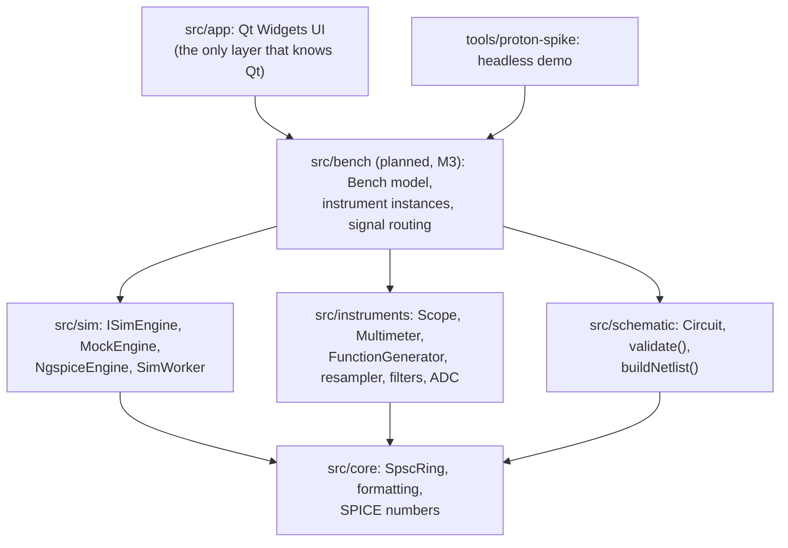
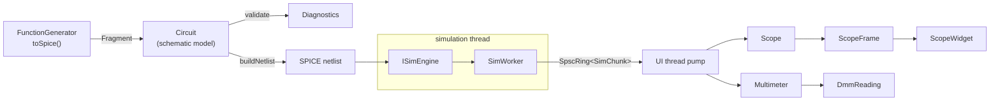
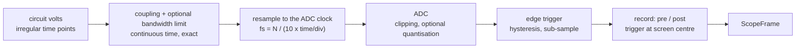

# Proton architecture

Proton is a virtual electronics bench. A student builds a circuit, connects instruments to it and
reads it the way they would on a real bench: setting time/div, V/div, trigger and ranges. The
measurements themselves are ideal (no noise, no probe loading), so the bench is a clean reference
for prototyping quickly, learning to use the instruments and comparing designs against. This
document explains how the pieces fit and, more importantly, **why** they are split the way they
are.

## 1. Principles

1. **Instruments model how they are operated, not how they degrade.** The simulator solves the
   circuit. Instruments turn that into what a physical device would display given its settings:
   timebase-derived sampling, triggering, coupling, ranges, gate times, clipping off screen. That
   is what a student has to learn, so it gets its own tested layer instead of being smeared across
   the UI. Imperfections that make a reading worse than the truth (noise, probe loading) are out of
   scope; quantisation and bandwidth limits are optional settings that default to ideal.
2. **Instruments are models; the UI is a view.** An instrument is plain C++ with no Qt, threads,
   clocks or I/O. It can be unit-tested against analytic results and reused by a CLI, a test
   harness, or a future headless grader for lab exercises.
3. **The simulator is replaceable.** Everything above `src/sim` talks to `ISimEngine`. ngspice is
   the first real backend, not a hard dependency of the architecture.
4. **Everything below the UI builds without Qt.** CI enforces it. Fast tests, easy sanitizers,
   and a license boundary that is easy to reason about.
5. **Determinism.** Same circuit and settings give the same netlist text and the same frames.
   Golden-file and regression tests depend on it.

## 2. Layers and dependency rules

Rules (see `CONTRIBUTING.md`): no Qt below `src/app`; `instruments` never depends on `sim` (it
consumes plain `(time, values)` arrays); `schematic` never depends on `instruments` (instrument
contributions arrive as plain `Fragment` data). Until milestone M3 the glue that connects them
lives in the app and in `tools/`, and `app` and `tools` depend on the three libraries directly;
M3 moves it into a Qt-free `src/bench` library (section 5.1). Milestones are defined in
[PLAN.md](PLAN.md).

## 3. Data flow

`SimChunk` is a block of `(time[], signals[][])` from the engine. Time points are strictly
increasing but **unevenly spaced**: SPICE picks its own steps. Turning that into evenly sampled
data is the instrument's job, exactly as a real ADC does.

## 4. Threads

| Thread | Owns | Notes |
|---|---|---|
| UI thread | `Circuit`, `Scope`, `Multimeter`, widgets | Instruments are never touched from another thread, so they need no locks |
| Simulation thread (`SimWorker`) | the `ISimEngine` | Produces `SimChunk`s, waits when the queue is full (backpressure) |
| ngspice background thread | internal to libngspice | Only with `NgspiceEngine`; its data callback blocks when the consumer lags |

Exactly one thing crosses from the simulation thread to the UI thread: `SpscRing<SimChunk>`, a
lock-free single-producer / single-consumer queue (`proton/core/spsc_ring.h`: power-of-two
capacity fixed at construction, move-only elements, release/acquire on the two indices,
non-blocking `tryPush` / `tryPop`; a full `tryPush` leaves its argument untouched so the producer
can wait and retry). Sample data never travels through Qt signals between threads. Changing a
knob (time/div, trigger level) is a call on the UI thread; changing the *circuit* stops the worker,
rebuilds the netlist, reloads the engine and restarts.

`SimWorker` (`proton/sim/sim_worker.h`, done in M0) owns the engine and a `std::jthread`. The
thread advances the engine one chunk (`chunkDuration`, 1 ms of simulation time by default) at a
time and pushes it into the ring (64 chunks by default). When the ring is full it keeps the chunk
and retries, with a few yields and then 100 us sleeps, checking for a stop each time: nothing is
dropped, and the wait never touches simulation time. `start(netlist)` stops any run, drops the
chunks it left, loads the engine on the calling thread and starts the thread; `stop()` requests a
stop and joins. Thread start and join order the engine's use between the two threads. Besides
the ring, only control state crosses threads: the stop request, and a failure flag stored with
release order after the error text, which is not written again until the thread is joined.

With `NgspiceEngine` the simulation thread does not compute anything itself: ngspice runs the
analysis on its own thread, and the engine's data callback copies each accepted time point into
a bounded queue private to the engine (a mutex and a condition variable, so neither side polls).
The callback waits while the queue is full, which holds ngspice back; `advance()` waits until a
point past the chunk's end arrives or the run ends. Halting sets a flag under the mutex first, so
a callback waiting on a full queue returns and later ones drop their point, then waits for
ngspice's thread to end.

Latency from circuit to pixel is roughly `chunkDuration + queue wait + frame cadence`. The defaults
(1 ms chunks, 16 ms UI tick) are a starting point to be measured in milestone M1.

## 5. The instrument contract

An instrument is a class that:

- has a `Config` struct and a `configure()` method. Like turning a physical knob it **restarts
  acquisition**, so state can never be inconsistent with settings;
- consumes simulation output through `feed(time, values)` and nothing else, where time is
  *simulation* time and never wall-clock time;
- returns results through `pop*()` (frames, readings), never via callbacks into UI code;
- sanitises impossible settings instead of trusting the UI;
- if it acts on the circuit (a generator, a power supply), describes itself as SPICE elements via
  `toSpice()`, returning a `SpiceFragment`.

| Instrument | Role | State |
|---|---|---|
| `Scope` | measures | done (M0): 2 channels, coupling, bandwidth limit, sampling, ADC, edge trigger, Auto / Normal / Single, see section 6; UI planned (M2) |
| `Multimeter` | measures | done (M0): DC V, AC V (true RMS), auto/fixed range, 4.5 digits; planned: DC current and resistance (M3) |
| `FunctionGenerator` | sources | model done (M0): sine/square/triangle/DC, output impedance; faceplate planned (M2) |
| DC power supply | sources | planned (M3); CC/CV after the MVP |
| Bode plotter | measures | planned, after the MVP (ngspice AC analysis) |
| Spectrum analyzer, VNA | measures | planned, RF (see ROADMAP) |

The function generator is an ideal source behind a series output resistor (50 ohm by default; 0
writes no resistor), between an output net and a reference net. Amplitude is peak volts and, like
the offset, an open-circuit value, so a 50 ohm load sees half; amplitude plus offset stays within
10 V either way. Sine is a SPICE `SIN`; square and triangle are `PULSE` sources whose corners take a
thousandth of a period (ngspice reads a pulse width of 0 as the whole run, so the triangle dwells
that long at each peak). `SpiceFragment` is the instruments' own type; the bench copies its lines
into a schematic `Fragment`, so neither library depends on the other.

The multimeter reads one probe voltage. It integrates over a gate of simulation time (100 ms by
default) and gives one `DmmReading` per gate, taking the signal as linear between the points it is
fed, so the integrals are exact on SPICE's irregular grid and do not depend on how the data is
chunked. DC V is the mean; AC V is the true RMS with the mean removed. Ranges run from 200 mV to
200 V on a 19999-count display; auto-range goes up on overload and down below 1800 counts, so
readings between the two stay on their range. `popReading()` returns only the newest reading, as
a display would.

### 5.1 The bench model (planned, milestone M3)

A real bench has any number of instruments, but until M3 the glue between engine, circuit and
instruments lives in `tools/proton-spike` and a temporary `BenchController` in the app, hard-wired
to one set of instruments. That glue becomes a Qt-free library, `src/bench`, tested headlessly and
shared by the app and the tools:

- `Bench` owns a list of instrument **instances** (kind, unique name, settings) and their
  **connections**: scope channels and multimeter inputs bind to nets (probes, measured against
  ground "0" at first); a generator or supply attaches its output to a net.
- Before a run, `Bench::contributeTo(Circuit&)` adds every source instrument's `Fragment` under a
  unique name (`gen1`, `gen2`, ...). `validate()` also rejects duplicate element names across
  components and fragments, case-insensitively because SPICE is.
- After the engine loads, `Bench::attach(signalNames)` resolves each probe's net to a signal index
  and reports probes whose net does not exist in the simulation: a clear error instead of a flat
  line.
- `Bench::feed(chunk)` routes each chunk to every measuring instrument; frames and readings are
  collected per instrument id.
- Instrument settings stay plain-data structs, so the bench can be serialised into the project
  file (M4) without touching the models.
- The UI is a thin view: add / remove instrument, one dockable panel per instance, each bound to a
  bench instrument id.

Dependencies: `bench` uses `core`, `instruments`, `schematic` and, from `sim`, only `SimChunk` and
`indexOfSignal`. `instruments` still does not depend on `sim`. Measurements are single-ended
(relative to ground) at first; differential probes come later. In M4 the schematic editor's probe
tool replaces binding probes to nets by name.

## 6. Oscilloscope signal path and fidelity

Order matters, and it is the order of a real instrument: the analog front end acts on the
continuous signal *before* sampling, so a signal above Nyquist aliases exactly as it would on
hardware. The front-end filter is evaluated in closed form on the simulator's irregular steps
(piecewise-linear input, exact RC response per step), so it is correct for any step size.

**MVP scope (M0):** two channels sharing timebase and trigger; timebase-derived sample rate with
fixed record length; clipping when the trace leaves the screen; DC/AC coupling; edge trigger with
hysteresis and sub-sample interpolation (stable display); Auto / Normal / Single; dead time
between acquisitions.

**Ideal by default, optional:** ADC quantisation (e.g. 8-bit) and a one-pole bandwidth limit. Off,
the scope shows the simulated voltage exactly at each sample. On, they serve as teaching aids
("why does my fast square wave look rounded?"), never as the default reading.

**Planned features** (tracked in the ROADMAP): cursors, measurements, averaging, FFT/math; holdoff;
delayed timebase; non-edge triggers; sin(x)/x display interpolation.

**Out of scope:** noise and probe or input impedance loading. The scope is an ideal, non-loading
voltmeter, so a reading is a benchmark of the circuit, not of the measurement setup.

The front end (`ScopeFrontEnd`) covers the first three boxes. Each filter is a one-pole
low-pass `z` of the input `x`, tracked as its error `e = z - x` and advanced exactly over every
step (`e' = -e / tau - dx / dt` for a linear input): AC coupling (fixed 10 Hz corner) is `-e_ac`,
the bandwidth limit is `x + e_bw`, and both together reduce by partial fractions to
`a (e_bw - e_ac) / (a - b)` with `a`, `b` the time constants. The bandwidth limit is kept at least
100 times above the AC corner so the two never meet. The filters start in steady state at the
first value fed. Each sample is evaluated from the state at the last point before it, so samples
between simulator points are exact too, and the output does not depend on chunking. A sample
interval is `10 x time/div / 1000`, counted from the first point fed. The screen is 8 divisions
centred on the channel offset (the voltage at screen centre); samples beyond it clip to its edge,
and with quantisation on a sample is `offset + code x LSB` with `LSB = 8 div / 2^bits`. Samples
are in volts at the probe tip.

`Scope` adds the last two boxes on the front end's samples. An acquisition first fills the
pre-trigger half of the record (500 samples), and only then arms the trigger. For a rising edge
the trigger arms when the source channel goes below `level - hysteresis` (hysteresis in divisions
of that channel) and fires at the first sample at or above `level`; falling is the mirror image.
The trigger time is interpolated linearly between that sample and the one before, and a
`ScopeFrame` carries it with the time of its first sample relative to it, so a periodic trace
stands still to a fraction of a sample. After the post-trigger half the frame is ready
(`popFrame()` keeps only the newest), and the next acquisition starts after the dead time
(simulation time, rounded up to whole samples, 0 by default). Normal gives frames only on a
trigger; Auto forces an untriggered frame when no trigger comes within two screens of simulation
time after arming (a real scope times out in wall-clock time, which Proton never uses); Single is
Normal that stops after one frame until `configure()`.

Known simplification: triggering runs on the post-ADC samples (a *digital* trigger). With
quantisation off this is identical to an analog trigger; with it on, it can differ slightly near
the threshold.

## 7. Circuit model and netlist

`Circuit` holds components (kind, reference designator, nets, value string) and opaque `Fragment`s
(pre-rendered SPICE lines from instruments, under the instrument's instance name), both in the
order they were added. Component kinds: resistor, capacitor, inductor, DC voltage and current
sources (nets `{positive, negative}` as in SPICE) and ground (one net, which becomes SPICE node
`0`). It is plain data compared by value. It deliberately contains no UI data: positions,
rotations and symbols belong to the editor's own scene model, which is *converted* into a `Circuit`.
This keeps the model serialisable and testable without a GUI.

`validate()` returns diagnostics for the mistakes beginners make most *before* the simulator turns
them into cryptic errors: no ground, invalid or duplicate designators (across components and
fragments, ignoring case as SPICE does), unconnected terminals, zero or unparsable values, net names
that are not one SPICE token (letters, digits, `_ - + .`), nets with a single connection (a
warning), and nets with no DC path to ground, which ngspice reports as a singular matrix. Each
`Diagnostic` carries a severity, a stable code, the element or net it is
about, and a sentence for the student; any error means the circuit is not simulated. Net names are
compared ignoring case; ground is node `0` plus every net a ground symbol sits on. For the DC path,
resistors, inductors and voltage sources conduct, capacitors and current sources do not. Fragment
lines are read only far enough for these checks (element name and two nodes, R/C/L/V/I elements);
any other line is itself a diagnostic, so a new instrument element must extend `validate()`.

`buildNetlist()` is a pure function: same circuit, same text, byte for byte. Components are written
sorted by designator in natural order (R2 before R10) and fragments sorted by name, so the text
does not depend on the order things were added in the editor. Ground nets become node `0`, in
fragment lines too; values are normalised through `formatSpiceNumber` (`10uF` becomes `10u`), so
ngspice never reads a student's spelling; sources are `DC <value>`. The text is the title line and
the elements only: the engine appends the analysis line (`.tran` / `.op`) and `.end`.

SPICE numbers (`proton/core/spice_number.h`, in `core` so instruments can write them too) follow
ngspice: scale factors `t g meg k mil m u n p f`, case-insensitive, and trailing letters ignored as
units. Hence the traps: `M` is milli (`meg` is mega), and `10F` is 10 femto, not 10 farad.
Parsing is locale-free and rounds the written decimal once to the nearest double;
`formatSpiceNumber` writes the shortest mantissa that parses back to the same double ("4.7k",
"1meg", "2.2u"), so format then parse is exact.

## 8. Simulation backends

`ISimEngine` (`proton/sim/sim_engine.h`) is a pull interface: `load(netlist) -> bool`,
`advance(duration) -> SimChunk`, `reset()`, plus `signalNames()` and `error()`. `load` takes the
netlist as `buildNetlist()` writes it and prepares a transient run from t = 0; on failure nothing is
loaded and `error()` says why (no exceptions, section 9). A run that fails in `advance` returns the
points before the failure, sets `error()`, and gives empty chunks until `load` or `reset`. Each `advance` returns the points in the
next `duration` seconds, t = 0 included in the first, with one signal per name. `SimChunk`
(`time[]`, `signals[s][i]`) is move-only, since it travels between threads by move.
`indexOfSignal(names, name)` finds a signal ignoring ASCII case, as SPICE does (`V(Out)` finds
`v(out)`).

- **`MockEngine`** (done, M0): deterministic sine and RC low-pass on an irregular grid. Used by
  tests, the headless demo and CI, so the whole pipeline is exercised without any external
  dependency. It ignores the netlist's elements (a blank netlist is a load error) and always gives
  `v(in)`, the sine, and `v(out)`, the RC output, starting from the DC operating point. Steps are
  drawn between `minStep` and `maxStep` from a fixed integer pseudo-random sequence that restarts
  at `load` and `reset`, so the grid does not depend on how the run is chunked and two runs are
  bit-identical. `v(out)` is advanced with the exact RC response to an input linear across each
  step; it matches the analytic answer to within that linearisation (second order in the step).
  For error-handling tests, `failAt` makes the run fail when it passes that simulation time.
- **`NgspiceEngine`** (`proton/sim/ngspice_engine.h`, done in M1.2, Windows only and built only
  when ngspice was fetched): libngspice's shared-library API, streaming accepted time points
  through a callback into a bounded queue (`queueCapacity`, 4096 points by default; section 4).
  The first `load()` loads `ngspice.dll` from the executable's directory with `LoadLibraryExW`,
  resolves the API with `GetProcAddress` and calls `ngSpice_Init` with the callbacks; the DLL then
  stays loaded until a fatal error, so a program that never loads this engine does not need it,
  and a missing DLL is a `load()` error. `load()` halts any run, frees the old circuit and plots (`remcirc`,
  `destroy all`), sends the netlist line by line plus `.tran maxStep stopTime 0 maxStep` and
  `.end` (`ngSpice_Circ`), and starts `bg_run`; it returns once the first point (the operating
  point at t = 0) is queued. A netlist ngspice reports an error for is a load error, and so is a
  line it ignores with a warning (`R1 in`), since simulating the circuit without it would be
  wrong; so is a circuit whose operating point ngspice cannot find. Signal names come from the
  first point: node `out` is `v(out)`, branch `v1#branch` is `i(v1)`, lower case, in ngspice's
  order. A point whose time is not after the previous one is dropped. The run ends at `stopTime`
  (10 s by default; `maxStep` 1 us): `advance()` gives the points up to it and then reports "the run
  reached its stop time" through `error()`, so `SimWorker` ends cleanly; endless runs are revisited
  with latency in M1.5. `reset()` loads the same netlist again. Only one engine
  may exist per process: while one does, every other one fails to load. Constraints (global state,
  backpressure by blocking the callback, fatal errors) are in `docs/adr/0002-simulation-backend.md`.
  Some netlist errors are fatal to ngspice (a missing `.include`, unmatched `.subckt` and `.ends`,
  a `.param` it cannot evaluate): it calls `ControlledExit` from inside `ngSpice_Circ` and is
  unusable afterwards (done in M1.4). The `load()` or `advance()` that meets one fails with
  "ngspice: fatal error: ..." and ngspice's message, which `SimWorker::error()` passes on; the next
  `load()` calls `ngSpice_Reset()`, frees the DLL (after ngspice's thread has ended, if the exit
  came on it) and loads it afresh. ngspice 46 leaks about 1 KiB per load, which only ending the
  process gives back; the numbers are in ADR 0002. The pinned release (ngspice 46) is fetched by `tools/fetch-ngspice.ps1` into
  `third_party/ngspice` (Windows only, done in M1.1); `cmake/ProtonNgspice.cmake` provides the
  header (`proton::ngspice_headers`) and copies the DLLs next to a binary
  (`proton_copy_ngspice_dlls`). Without a fetch the build has no ngspice and everything else works.
- **RF**: ngspice is weak at harmonic balance and S-parameters, so a spectrum analyzer starts as an
  FFT of transient data and a VNA as a dedicated small-signal solver. Decided when RF work begins.

## 9. Error handling

No exceptions across threads. Static problems surface as `Diagnostic`s; engine problems as
`load()` errors or `SimWorker::error()`: `start()` returns false when the netlist does not load,
and a run that fails in the engine ends its thread, keeps every chunk produced before the
failure, and reports the engine's message. A failing simulation never takes down the UI.

## 10. Testing strategy

- **Unit tests** per module, one executable each, with a dependency-free harness (`tests/support`:
  `TEST`, non-fatal `CHECK` / `CHECK_EQ` / `CHECK_NEAR` that print file, line and both values).
- **Analytic checks** instead of eyeballing: RC corner is exactly -3 dB, true RMS of a sine is
  0.7071, ADC steps are exact multiples of the LSB, the one-pole filter matches its closed form.
- **Golden netlists** for the schematic layer: `tests/golden/netlist/*.cir`, compared byte for byte
  and kept LF on every platform by `.gitattributes`. A mismatch writes the actual text to
  `golden-actual/` in the test's build directory.
- **Integration test** (`tests/integration`, done in M0): circuit -> netlist -> worker thread ->
  scope and multimeter, with the mock engine, on every commit. It runs the RC example (1 kHz sine,
  1 V around 0.5 V, into 1 k and 100 n) through `proton::spike::run`, the same pipeline code
  `proton-spike` uses (`tools/proton-spike`, a small library plus the executable), and checks:
  the netlist against `tests/golden/integration/`; DMM DC 0.5 V and AC `0.8467 / sqrt(2)` V;
  every frame triggered on a whole period to a fraction of a sample, with CH2 the analytic steady
  state (gain 0.8467, -32.1 degrees); identical results across runs and across chunk durations and
  queue capacities; errors from `validate()` and from the engine. The pump feeds only points up
  to the run's duration and pops after every chunk, so chunks must stay shorter than a frame and
  a gate. `PipelineSettings::engine` picks `Mock` (the default) or `Ngspice`; `proton::sim`
  defines `PROTON_HAVE_NGSPICE` for its users when the build has ngspice, and without it choosing
  ngspice is an error. The mock does not read the netlist, so the pipeline sets it up from the
  same generator, R and C settings, with a sine generator of output impedance 0. ngspice reads the
  netlist, runs with a 10 us maximum step and stops one chunk after the duration. The same test
  source is built a second time on ngspice (`integration_ngspice`, M1.3) with the same checks and
  tolerances, less the two mock-only tests (a square generator refused, a failure injected) and
  plus one that ngspice runs a square generator behind 50 ohm. `proton-spike [--duration s]`
  prints the netlist and readings as `#` comments and the last frame as CSV
  (`t_rel_s,ch1_v_in,ch2_v_out`); CTest also runs it (`proton_spike_runs`).
- **Sanitizers** (ASan/UBSan and TSan) in CI because the threading code is the riskiest code.
  The `SpscRing` stress test (two threads, 10^6 items, order and count checked) runs under TSan.
  CI (`.github/workflows/ci.yml`): a Windows MSVC job (Debug and Release) and a Linux clang job
  (`linux-clang-asan`, `linux-clang-tsan`) with no Qt installed, all with warnings as errors.
- **ngspice tests** run one executable per process because libngspice keeps process-wide state.
  `ngspice_dll` (M1.1) checks that the fetched DLL loads next to the test, exports the API and runs
  a command. `ngspice_engine` (M1.2) runs the RC example through `NgspiceEngine`: chunks hold
  strictly increasing times within their own slice and start at t = 0, the source matches its
  formula, broken and unsolvable netlists are load errors after which a valid one runs, the run
  ends at its stop time, `reset()` repeats a run exactly, a one-point queue with a slow consumer
  gives the same points (backpressure), `load()` halts a run blocked on a full queue, a second
  instance is refused, and the engine runs under `SimWorker`; fatal netlist errors (M1.4) are load
  errors, under `SimWorker` too, after which the reloaded ngspice runs the RC example exactly as
  before. `ngspice_soak` (M1.4) measures private memory over 1000 load/reset cycles and over 200
  fatal-error reloads, prints it, and fails above 2 KiB per cycle and 16 KiB per reload.
  `ngspice_validation` (M1.3) checks
  ngspice against analytic answers, each with a tolerance stated in the test (about ten times what
  ngspice 46 gives; resistive circuits are exact to rounding): an RC step follows
  `1 - exp(-t / tau)` pointwise to 30 uV and crosses `1 - 1/e` at tau to 3e-5; an RC low-pass
  driven at its corner by a generator fragment is -3.0103 dB to 2e-4 dB and -45 degrees to
  0.001 degree, measured by a single-frequency DFT over whole periods of steady state; a 10 V
  divider over 1 k and 3 k gives 7.5 V and `i(v1)` = -2.5 mA; a generator fragment behind 50 ohm
  gives a resistive load its share of the open-circuit sine and DC at every point, and `i(vgen1)`
  is minus the load current. They are built only when ngspice was
  fetched; the Windows CI jobs fetch it (cached)
  and configure with `PROTON_REQUIRE_NGSPICE=ON`, so they cannot silently skip them.
- **Repository checks** run as CTest tests on every preset: `spdx_headers`
  (`tools/check-spdx.cmake`) fails on a source file without the SPDX license line.
- **Next:** circuit-to-frame latency and live changes (M1.5); UI is
  covered by smoke tests only: logic belongs below the UI, where it is testable.

## 11. Planned UI architecture (Qt, `src/app`)

- Qt 6 **Widgets**, custom `QPainter` drawing for the scope and meter displays (no Qt Charts: see
  ADR 0004). QML or `QRhi` can be revisited if rendering becomes a bottleneck.
- **Schematic editor**: `QGraphicsScene`/`QGraphicsView` with its own scene model, converted to a
  `Circuit` for simulation. Undo/redo with `QUndoStack`.
- **Bench**: dockable instrument panels (faceplate widget + display widget), each bound to one
  instrument instance of the `Bench` model (section 5.1).
- **Project files**: versioned JSON holding the scene, instrument settings and probe connections.

## 12. Extension points

- **New instrument:** model class in `src/instruments` following section 5, tests first, then a
  faceplate in `src/app`.
- **New engine:** implement `ISimEngine`; nothing else changes.
- **New component:** extend `ComponentKind`, `validate()` and `buildNetlist()` with a test; ship
  an original model, never a vendor model (see `docs/LICENSING.md`).
- **Troubleshooting mode (v2):** a hidden *fault* is a transformation applied to the `Circuit`
  between the schematic the student sees and the netlist that is simulated (open a component, short
  two nets, drift a value). Because `Circuit` is plain data, this needs no change to engines or
  instruments.

## 13. Open questions

- **Live knob feel for the circuit itself** (a potentiometer in the schematic): restart the run,
  or pause the ngspice run, `alter` the value and resume? Decided from measurements in M1.5
  (PLAN.md decision D3).
- **Real-time pacing:** `SimWorker` can pace simulation to wall-clock time; whether the bench
  should always run in real time, or only for slow timebases, is a UX decision.
