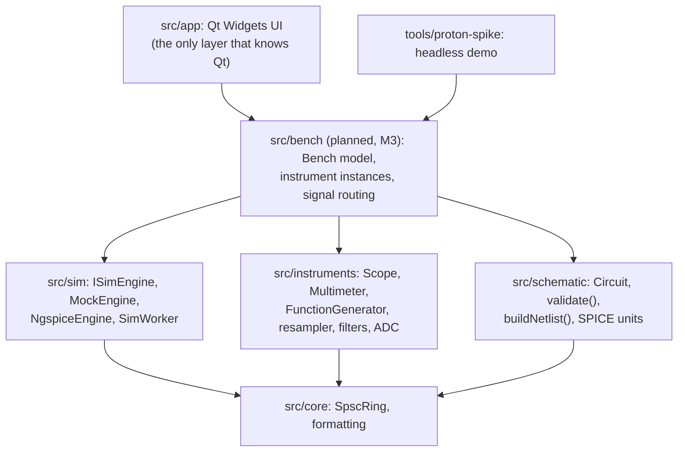
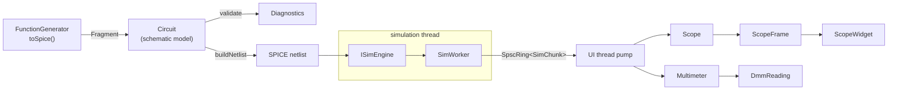
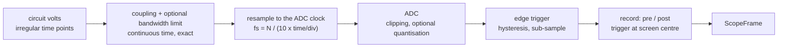

# Proton architecture

Proton is a virtual electronics bench. A student builds a circuit, connects instruments to it and
reads it the way they would on a real bench: setting time/div, V/div, trigger and ranges. The
measurements themselves are ideal (no noise, no probe loading), so the bench is a clean reference
for prototyping quickly, learning to use the instruments and comparing designs against. This
document explains how the pieces fit and, more importantly, **why** they are split the way they
are.

## 1. Principles

1. **Instruments model how they are operated, not how they degrade.** The simulator solves the
   circuit. Instruments turn that into what a physical device would display given its settings:
   timebase-derived sampling, triggering, coupling, ranges, gate times, clipping off screen. That
   is what a student has to learn, so it gets its own tested layer instead of being smeared across
   the UI. Imperfections that make a reading worse than the truth (noise, probe loading) are out of
   scope; quantisation and bandwidth limits are optional settings that default to ideal.
2. **Instruments are models; the UI is a view.** An instrument is plain C++ with no Qt, threads,
   clocks or I/O. It can be unit-tested against analytic results and reused by a CLI, a test
   harness, or a future headless grader for lab exercises.
3. **The simulator is replaceable.** Everything above `src/sim` talks to `ISimEngine`. ngspice is
   the first real backend, not a hard dependency of the architecture.
4. **Everything below the UI builds without Qt.** CI enforces it. Fast tests, easy sanitizers,
   and a license boundary that is easy to reason about.
5. **Determinism.** Same circuit and settings give the same netlist text and the same frames.
   Golden-file and regression tests depend on it.

## 2. Layers and dependency rules

Rules (see `CONTRIBUTING.md`): no Qt below `src/app`; `instruments` never depends on `sim` (it
consumes plain `(time, values)` arrays); `schematic` never depends on `instruments` (instrument
contributions arrive as plain `Fragment` data). Until milestone M3 the glue that connects them
lives in the app and in `tools/`, and `app` and `tools` depend on the three libraries directly;
M3 moves it into a Qt-free `src/bench` library (section 5.1). Milestones are defined in
[PLAN.md](PLAN.md).

## 3. Data flow

`SimChunk` is a block of `(time[], signals[][])` from the engine. Time points are strictly
increasing but **unevenly spaced**: SPICE picks its own steps. Turning that into evenly sampled
data is the instrument's job, exactly as a real ADC does.

## 4. Threads

| Thread | Owns | Notes |
|---|---|---|
| UI thread | `Circuit`, `Scope`, `Multimeter`, widgets | Instruments are never touched from another thread, so they need no locks |
| Simulation thread (`SimWorker`) | the `ISimEngine` | Produces `SimChunk`s, waits when the queue is full (backpressure) |
| ngspice background thread | internal to libngspice | Only with `NgspiceEngine`; its data callback blocks when the consumer lags |

Exactly one thing crosses a thread boundary: `SpscRing<SimChunk>`, a lock-free single-producer /
single-consumer queue (`proton/core/spsc_ring.h`: power-of-two capacity fixed at construction,
move-only elements, release/acquire on the two indices, non-blocking `tryPush` / `tryPop`; a full
`tryPush` leaves its argument untouched so the producer can wait and retry). Sample data never
travels through Qt signals between threads. Changing a
knob (time/div, trigger level) is a call on the UI thread; changing the *circuit* stops the worker,
rebuilds the netlist, reloads the engine and restarts.

Latency from circuit to pixel is roughly `chunkDuration + queue wait + frame cadence`. The defaults
(1 ms chunks, 16 ms UI tick) are a starting point to be measured in milestone M1.

## 5. The instrument contract

An instrument is a class that:

- has a `Config` struct and a `configure()` method. Like turning a physical knob it **restarts
  acquisition**, so state can never be inconsistent with settings;
- consumes simulation output through `feed(time, values)` and nothing else, where time is
  *simulation* time and never wall-clock time;
- returns results through `pop*()` (frames, readings), never via callbacks into UI code;
- sanitises impossible settings instead of trusting the UI;
- if it acts on the circuit (a generator, a power supply), describes itself as SPICE elements via
  `toSpice()`, returning a `SpiceFragment`.

| Instrument | Role | State |
|---|---|---|
| `Scope` | measures | planned (M0): 2 channels, see section 6 |
| `Multimeter` | measures | planned: DC V, AC V (true RMS), auto/fixed range, 4.5 digits (M0); DC current and resistance (M3) |
| `FunctionGenerator` | sources | planned (M0): sine/square/triangle/DC, output impedance |
| DC power supply | sources | planned (M3); CC/CV after the MVP |
| Bode plotter | measures | planned, after the MVP (ngspice AC analysis) |
| Spectrum analyzer, VNA | measures | planned, RF (see ROADMAP) |

### 5.1 The bench model (planned, milestone M3)

A real bench has any number of instruments, but until M3 the glue between engine, circuit and
instruments lives in `tools/proton-spike` and a temporary `BenchController` in the app, hard-wired
to one set of instruments. That glue becomes a Qt-free library, `src/bench`, tested headlessly and
shared by the app and the tools:

- `Bench` owns a list of instrument **instances** (kind, unique name, settings) and their
  **connections**: scope channels and multimeter inputs bind to nets (probes, measured against
  ground "0" at first); a generator or supply attaches its output to a net.
- Before a run, `Bench::contributeTo(Circuit&)` adds every source instrument's `Fragment` under a
  unique name (`gen1`, `gen2`, ...). `validate()` also rejects duplicate element names across
  components and fragments, case-insensitively because SPICE is.
- After the engine loads, `Bench::attach(signalNames)` resolves each probe's net to a signal index
  and reports probes whose net does not exist in the simulation: a clear error instead of a flat
  line.
- `Bench::feed(chunk)` routes each chunk to every measuring instrument; frames and readings are
  collected per instrument id.
- Instrument settings stay plain-data structs, so the bench can be serialised into the project
  file (M4) without touching the models.
- The UI is a thin view: add / remove instrument, one dockable panel per instance, each bound to a
  bench instrument id.

Dependencies: `bench` uses `core`, `instruments`, `schematic` and, from `sim`, only `SimChunk` and
`indexOfSignal`. `instruments` still does not depend on `sim`. Measurements are single-ended
(relative to ground) at first; differential probes come later. In M4 the schematic editor's probe
tool replaces binding probes to nets by name.

## 6. Oscilloscope signal path and fidelity

Order matters, and it is the order of a real instrument: the analog front end acts on the
continuous signal *before* sampling, so a signal above Nyquist aliases exactly as it would on
hardware. The front-end filter is evaluated in closed form on the simulator's irregular steps
(piecewise-linear input, exact RC response per step), so it is correct for any step size.

**MVP scope (M0):** two channels sharing timebase and trigger; timebase-derived sample rate with
fixed record length; clipping when the trace leaves the screen; DC/AC coupling; edge trigger with
hysteresis and sub-sample interpolation (stable display); Auto / Normal / Single; dead time
between acquisitions.

**Ideal by default, optional:** ADC quantisation (e.g. 8-bit) and a one-pole bandwidth limit. Off,
the scope shows the simulated voltage exactly at each sample. On, they serve as teaching aids
("why does my fast square wave look rounded?"), never as the default reading.

**Planned features** (tracked in the ROADMAP): cursors, measurements, averaging, FFT/math; holdoff;
delayed timebase; non-edge triggers; sin(x)/x display interpolation.

**Out of scope:** noise and probe or input impedance loading. The scope is an ideal, non-loading
voltmeter, so a reading is a benchmark of the circuit, not of the measurement setup.

Known simplification: triggering runs on the post-ADC samples (a *digital* trigger). With
quantisation off this is identical to an analog trigger; with it on, it can differ slightly near
the threshold.

## 7. Circuit model and netlist

`Circuit` holds components (kind, reference designator, nets, value string) and opaque `Fragment`s
(pre-rendered SPICE lines from instruments, under the instrument's instance name), both in the
order they were added. Component kinds: resistor, capacitor, inductor, DC voltage and current
sources (nets `{positive, negative}` as in SPICE) and ground (one net, which becomes SPICE node
`0`). It is plain data compared by value. It deliberately contains no UI data: positions,
rotations and symbols belong to the editor's own scene model, which is *converted* into a `Circuit`.
This keeps the model serialisable and testable without a GUI.

`validate()` returns diagnostics for the mistakes beginners make most (no ground, duplicate
designators, zero or unparsable values, floating nodes) *before* the simulator turns them into
cryptic errors. `buildNetlist()` is a pure function: same circuit, same text.

SPICE numbers (`units.h`) follow ngspice: scale factors `t g meg k mil m u n p f`,
case-insensitive, and trailing letters ignored as units. Hence the traps: `M` is milli (`meg` is
mega), and `10F` is 10 femto, not 10 farad. Parsing is locale-free and rounds the written decimal
once to the nearest double; `formatSpiceNumber` writes the shortest mantissa that parses back to
the same double ("4.7k", "1meg", "2.2u"), so format then parse is exact.

## 8. Simulation backends

`ISimEngine` is a pull interface: `load(netlist)`, `advance(duration) -> SimChunk`, `reset()`.

- **`MockEngine`**: deterministic sine and RC low-pass on an irregular grid. Used by tests, the
  headless demo and CI, so the whole pipeline is exercised without any external dependency.
- **`NgspiceEngine`**: libngspice shared-library API, streaming accepted time points through a
  callback into a bounded queue. Constraints (global state, one instance per process, backpressure
  by blocking the callback) are in `docs/adr/0002-simulation-backend.md`. Loaded at runtime, so
  the app runs on the mock engine without it and can reload it after a fatal error. Milestone M1.
- **RF**: ngspice is weak at harmonic balance and S-parameters, so a spectrum analyzer starts as an
  FFT of transient data and a VNA as a dedicated small-signal solver. Decided when RF work begins.

## 9. Error handling

No exceptions across threads. Static problems surface as `Diagnostic`s; engine problems as
`load()` errors or `SimWorker::error()`. A failing simulation never takes down the UI.

## 10. Testing strategy

- **Unit tests** per module, one executable each, with a dependency-free harness (`tests/support`:
  `TEST`, non-fatal `CHECK` / `CHECK_EQ` / `CHECK_NEAR` that print file, line and both values).
- **Analytic checks** instead of eyeballing: RC corner is exactly -3 dB, true RMS of a sine is
  0.7071, ADC steps are exact multiples of the LSB, the one-pole filter matches its closed form.
- **Golden netlists** for the schematic layer.
- **Integration test** (`tests/integration`): circuit -> netlist -> worker thread -> scope and
  multimeter, with the mock engine, on every commit.
- **Sanitizers** (ASan/UBSan and TSan) in CI because the threading code is the riskiest code.
  The `SpscRing` stress test (two threads, 10^6 items, order and count checked) runs under TSan.
  CI (`.github/workflows/ci.yml`): a Windows MSVC job (Debug and Release) and a Linux clang job
  (`linux-clang-asan`, `linux-clang-tsan`) with no Qt installed, all with warnings as errors.
- **Repository checks** run as CTest tests on every preset: `spdx_headers`
  (`tools/check-spdx.cmake`) fails on a source file without the SPDX license line.
- **Next:** the same RC circuit through ngspice compared against the analytic answer (M1); UI is
  covered by smoke tests only: logic belongs below the UI, where it is testable.

## 11. Planned UI architecture (Qt, `src/app`)

- Qt 6 **Widgets**, custom `QPainter` drawing for the scope and meter displays (no Qt Charts: see
  ADR 0004). QML or `QRhi` can be revisited if rendering becomes a bottleneck.
- **Schematic editor**: `QGraphicsScene`/`QGraphicsView` with its own scene model, converted to a
  `Circuit` for simulation. Undo/redo with `QUndoStack`.
- **Bench**: dockable instrument panels (faceplate widget + display widget), each bound to one
  instrument instance of the `Bench` model (section 5.1).
- **Project files**: versioned JSON holding the scene, instrument settings and probe connections.

## 12. Extension points

- **New instrument:** model class in `src/instruments` following section 5, tests first, then a
  faceplate in `src/app`.
- **New engine:** implement `ISimEngine`; nothing else changes.
- **New component:** extend `ComponentKind`, `validate()` and `buildNetlist()` with a test; ship
  an original model, never a vendor model (see `docs/LICENSING.md`).
- **Troubleshooting mode (v2):** a hidden *fault* is a transformation applied to the `Circuit`
  between the schematic the student sees and the netlist that is simulated (open a component, short
  two nets, drift a value). Because `Circuit` is plain data, this needs no change to engines or
  instruments.

## 13. Open questions

- **Live knob feel for the circuit itself** (a potentiometer in the schematic): restart the run,
  or pause the ngspice run, `alter` the value and resume? Decided from measurements in M1.5
  (PLAN.md decision D3).
- **Real-time pacing:** `SimWorker` can pace simulation to wall-clock time; whether the bench
  should always run in real time, or only for slow timebases, is a UX decision.
