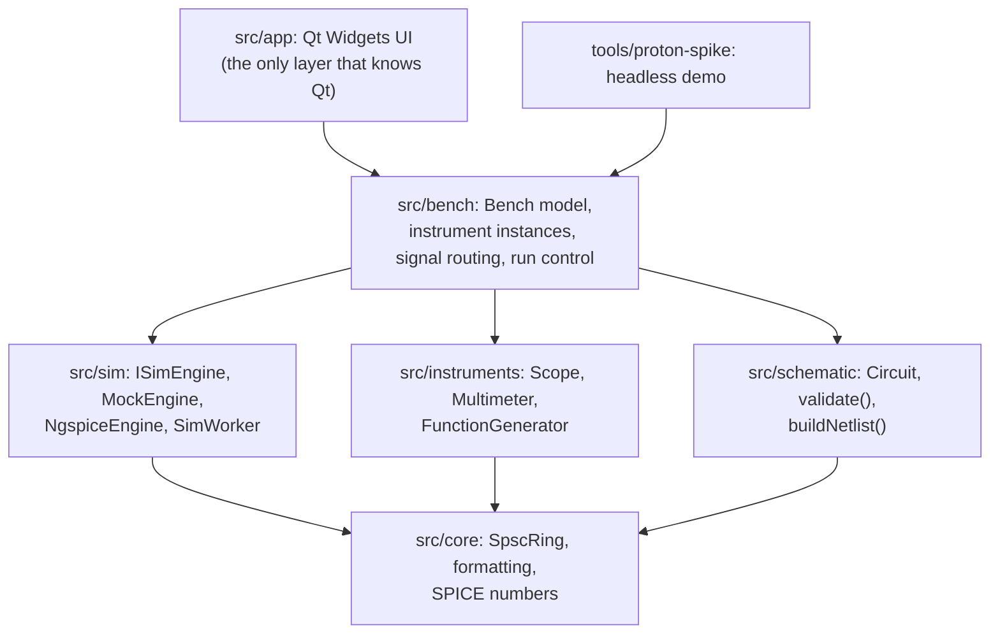
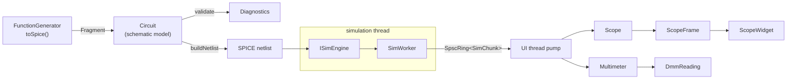
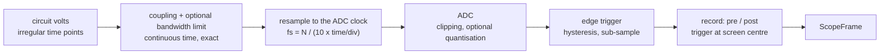

# Proton architecture

Proton is a virtual electronics bench. A student builds a circuit, connects instruments to it and
reads it the way they would on a real bench: setting time/div, V/div, trigger and ranges. The
measurements themselves are ideal (no noise, no probe loading), so the bench is a clean reference
for prototyping quickly, learning to use the instruments and comparing designs against. This
document explains how the pieces fit and, more importantly, **why** they are split the way they
are.

**What belongs here.** Layers, dependency rules, data flow, threads, contracts, invariants and the
reasons for them. It is not a record of how each class works (that is the class's header
comment), of measurements and the choices they support (the ADRs in [adr/](adr/)), of what each
test checks (the tests), or of what was built when ([PLAN.md](PLAN.md)). Update it when a layer, a
dependency, a thread, a contract or an invariant changes, not after every task.

## 1. Principles

1. **Instruments model how they are operated, not how they degrade.** The simulator solves the
   circuit. Instruments turn that into what a physical device would display given its settings:
   timebase-derived sampling, triggering, coupling, ranges, gate times, clipping off screen. That
   is what a student has to learn, so it gets its own tested layer instead of being smeared across
   the UI. Imperfections that make a reading worse than the truth (noise, probe loading) are out of
   scope; quantisation and bandwidth limits are optional settings that default to ideal.
2. **Instruments are models; the UI is a view.** An instrument is plain C++ with no Qt, threads,
   clocks or I/O. It can be unit-tested against analytic results and reused by a CLI, a test
   harness, or a future headless grader for lab exercises.
3. **The simulator is replaceable.** Everything above `src/sim` talks to `ISimEngine`. ngspice is
   the first real backend, not a hard dependency of the architecture.
4. **Everything below the UI builds without Qt.** CI enforces it. Fast tests, easy sanitizers,
   and a license boundary that is easy to reason about.
5. **Determinism.** Same circuit and settings give the same netlist text and the same frames.
   Golden-file and regression tests depend on it.

## 2. Layers and dependency rules

Rules (see `CONTRIBUTING.md`, ADR 0001): no Qt below `src/app`; `instruments` never depends on
`sim` (it consumes plain `(time, values)` arrays); `schematic` never depends on `instruments`
(instrument contributions arrive as plain `Fragment` data). The glue that connects engine, circuit
and instruments is logic, so it lives in the Qt-free `src/bench`, not in the app.

## 3. Data flow

`SimChunk` is a block of `(time[], signals[][])` from the engine. Time points are strictly
increasing but **unevenly spaced**: SPICE picks its own steps. Turning that into evenly sampled
data is the instrument's job, exactly as a real ADC does.

## 4. Threads

| Thread | Owns | Notes |
|---|---|---|
| UI thread | `Circuit`, instruments, bench, widgets | Instruments are never touched from another thread, so they need no locks |
| Simulation thread (`SimWorker`) | the `ISimEngine` | Produces `SimChunk`s, waits when the queue is full (backpressure) |
| ngspice background thread | internal to libngspice | Only with `NgspiceEngine`; hands points to the engine through a bounded queue private to it |

Exactly one thing crosses from the simulation thread to the UI thread: `SpscRing<SimChunk>`, a
lock-free single-producer / single-consumer queue. Sample data never travels through Qt signals
between threads. Besides the ring, only control state crosses: a stop request and a failure flag.

`SimWorker` owns the engine and its thread. It advances the engine one chunk of simulation time at
a time and pushes each chunk into the ring; when the ring is full it waits, so nothing is ever
dropped and the waiting never touches simulation time.

**Time model** (decision D6, ADR 0007). The bench runs in real time: the consumer of the ring
feeds its instruments only the output that is due by wall-clock time (`RealTimePacer`), and a
full ring holds the simulator back. Pacing changes when instruments are fed, never what they
see; the pacer is handed wall-clock time and reads no clock itself. A simulator slower than real
time is fed whatever it gives, and the pacer reports its speed. Runs are endless. The engine's
longest step is one sample of the fastest scope's timebase.

Changing an instrument knob (trigger level, V/div) is a call on the UI thread; so is time/div,
unless it changes the engine's step, which restarts the run. Changing the *circuit*, including a
generator knob, rebuilds the netlist and restarts the run (decision D3, ADR 0005); changes that
must keep the circuit's state are an open question (section 13). A restart reaches the scope in
tens of milliseconds (ADR 0005).

## 5. The instrument contract

An instrument is a class that:

- has a `Config` struct and a `configure()` method. Like turning a physical knob it **restarts
  acquisition**, so state can never be inconsistent with settings;
- consumes simulation output through `feed(time, values)` and nothing else, where time is
  *simulation* time and never wall-clock time;
- returns results through `pop*()` (frames, readings), never via callbacks into UI code;
- sanitises impossible settings instead of trusting the UI;
- if it acts on the circuit (a generator, a power supply), describes itself as SPICE elements via
  `toSpice()`, returning a `SpiceFragment`. The bench copies its lines into a schematic `Fragment`,
  so neither library depends on the other.

| Instrument | Role | Model |
|---|---|---|
| `Scope` | measures | 2 channels sharing timebase and trigger (section 6) |
| `Multimeter` | measures | one probe voltage integrated over a gate of simulation time; DC V and true-RMS AC V |
| `FunctionGenerator` | sources | an ideal source behind a series output resistor; amplitude and offset are open-circuit values |
| DC power supply | sources | planned |
| Bode plotter, spectrum analyzer, VNA | measures | after the MVP (ROADMAP) |

Measurements on the irregular SPICE grid are exact: instruments take the signal as linear between
the points they are fed and integrate or filter it in closed form, so results do not depend on step
size or on how the run is chunked.

### 5.1 The bench model

A real bench has any number of instruments. The glue between engine, circuit and instruments is a
Qt-free library, `src/bench`, tested headlessly and shared by the app and the tools:

- `Bench` owns a list of instrument **instances** (kind, unique name, settings) and their
  **connections**: scope channels and multimeter inputs bind to nets (probes, measured against
  ground "0" at first); a generator or supply attaches its output to a net.
- Before a run, `Bench::contributeTo(Circuit&)` adds every source instrument's `Fragment` under a
  unique name (`gen1`, `gen2`, ...).
- After the engine loads, `Bench::attach(signalNames)` resolves each probe's net to a signal and
  reports probes whose net does not exist: a clear error instead of a flat line.
- `Bench::feed(chunk)` routes each chunk to every measuring instrument; frames and readings are
  collected per instrument id.
- Run control lives here too: when a change restarts the run, how changes are coalesced, and how
  simulation time relates to wall-clock time (section 4).
- Instrument settings stay plain-data structs, so the bench can be serialised into the project
  file without touching the models.
- The UI is a thin view: one dockable panel per instance, each bound to a bench instrument id.

`bench` uses `core`, `instruments`, `schematic` and, from `sim`, the worker, `SimChunk` and
`indexOfSignal`. `instruments` still does not depend on `sim`. Measurements are single-ended
(relative to ground) at first; differential probes come later.

## 6. Oscilloscope signal path

Order matters, and it is the order of a real instrument: the analog front end acts on the
continuous signal *before* sampling, so a signal above Nyquist aliases exactly as it would on
hardware. `ScopeFrontEnd` covers the first three boxes and `Scope` the last two; their headers
give the details.

- **Ideal by default.** With quantisation and the bandwidth limit off (the default), a sample is
  the simulated voltage at its time. On, they are teaching aids ("why does my fast square wave
  look rounded?"), never the default reading.
- **Simulation time only.** Auto mode times out after a span of simulation time, where a real scope
  uses wall-clock time.
- **Known simplification:** the trigger looks at post-ADC samples (a digital trigger). With
  quantisation off this is identical to an analog trigger.
- **Out of scope:** noise and probe or input loading. The scope is an ideal, non-loading voltmeter.

## 7. Circuit model and netlist

`Circuit` holds components (kind, designator, nets, value text) and opaque `Fragment`s (SPICE lines
from instruments). It is plain data compared by value and deliberately contains no UI data:
positions and symbols belong to the editor's scene model, which is *converted* into a `Circuit`.
This keeps it serialisable, testable without a GUI, and open to transformations such as hidden
faults (section 12).

`validate()` catches the mistakes beginners make most (no ground, duplicate designators,
unconnected terminals, bad values, nets with no DC path to ground) *before* the simulator turns
them into cryptic errors, and phrases each as a sentence for the student. Any error means the
circuit is not simulated. It reads fragment lines too, so a new kind of instrument element must
extend it.

`buildNetlist()` is a pure function: same circuit, same text, byte for byte, whatever order things
were added in. Values are normalised, so ngspice never reads a student's spelling. The netlist has
no analysis line; the engine adds it. SPICE numbers live in `core` and follow ngspice, traps
included (`M` is milli, `meg` is mega).

## 8. Simulation backends

`ISimEngine` is a pull interface for a transient run: `load(netlist)`, `advance(duration)` giving
the next chunk, `reset()`, `signalNames()` and `error()`. Errors are values, never exceptions. Other
analyses (operating point, AC) are not part of it yet (section 13).

- **`MockEngine`:** deterministic sine and RC low-pass on an irregular grid, ignoring the netlist's
  elements. It exists so tests and the headless demo exercise the whole pipeline without an
  external dependency. Because it ignores the circuit, it is never a fallback in the app.
- **`NgspiceEngine`:** libngspice's shared-library API, loaded at runtime: the official DLL on
  Windows (ADR 0002), and on Linux the same release built from source for the sanitizer CI jobs
  (ADR 0008). ngspice runs the analysis on its own thread; a data callback copies each accepted
  point into a bounded queue and blocks while it is full, which is the only backpressure ngspice
  allows. ngspice keeps process-wide state, so one engine may exist per process. It halts through
  a source of its own instead of `bg_halt` (ADR 0005), and recovers from ngspice's fatal errors by
  reloading the DLL (ADR 0002). ngspice keeps no plot of the run, so points reach Proton only
  through the callback and a run can last indefinitely (ADR 0007).
- **RF**: ngspice is weak at harmonic balance and S-parameters, so a spectrum analyzer starts as an
  FFT of transient data and a VNA as a dedicated small-signal solver. Decided when RF work begins.

## 9. Error handling

No exceptions across threads. Static problems surface as `Diagnostic`s; engine problems as
`load()` errors or `SimWorker::error()`. A run that fails keeps every chunk produced before the
failure and reports the engine's message. A failing simulation never takes down the UI.

## 10. Testing strategy

- **Unit tests** per module, one executable each, with a dependency-free harness (`tests/support`).
- **Analytic checks** instead of eyeballing: RC corner is exactly -3 dB, true RMS of a sine is
  0.7071, ADC steps are exact multiples of the LSB.
- **Golden netlists** for the schematic layer, compared byte for byte.
- **Integration test:** circuit -> netlist -> worker thread -> scope and multimeter, through the
  same pipeline code as `proton-spike`, on the mock engine on every preset and on ngspice where it
  is built.
- **ngspice tests** run one executable per process, because libngspice keeps process-wide state.
  They validate ngspice against analytic answers; soak and latency tests print the numbers that the
  ADRs record. Every CI job requires ngspice, so none can silently skip these.
- **Sanitizers** (ASan/UBSan and TSan) on Linux, because threading code is the riskiest code,
  `NgspiceEngine` and its exchange with ngspice's thread included. ngspice's own per-load leaks
  are suppressed by their allocator, so Proton's leaks still show (`tests/lsan.supp`).
- **Repository checks:** every source file carries the SPDX line.
- **UI:** smoke tests only. Logic belongs below the UI, where it is testable.

## 11. UI architecture (Qt, `src/app`)

- Qt 6 **Widgets**, custom `QPainter` drawing for the scope and meter displays (no Qt Charts: see
  ADR 0004). QML or `QRhi` can be revisited if rendering becomes a bottleneck.
- **Schematic editor**: `QGraphicsScene`/`QGraphicsView` with its own scene model, converted to a
  `Circuit` for simulation. Undo/redo with `QUndoStack`.
- **Bench**: dockable instrument panels (faceplate widget + display widget), each bound to one
  instrument instance of the `Bench` model (section 5.1). The app owns the UI timer that pumps the
  bench; it holds no simulation logic of its own.
- **Project files**: versioned JSON holding the scene, instrument settings and probe connections.

## 12. Extension points

- **New instrument:** model class in `src/instruments` following section 5, tests first, then a
  faceplate in `src/app`.
- **New engine:** implement `ISimEngine`; nothing else changes.
- **New component:** extend `ComponentKind`, `validate()` and `buildNetlist()` with a test; ship
  an original model, never a vendor model (see `docs/LICENSING.md`).
- **Troubleshooting mode (v2):** a hidden *fault* is a transformation applied to the `Circuit`
  between the schematic the student sees and the netlist that is simulated (open a component, short
  two nets, drift a value). Because `Circuit` is plain data, this needs no change to engines or
  instruments.

## 13. Open questions

Each has a decision in the [PLAN.md](PLAN.md) Decisions table.

- **Live changes that must keep the circuit's state (D7).** A restart computes a fresh operating
  point, so closing a switch on an RC starts with the capacitor already charged and the student
  never sees the charge. Switches and potentiometers need the circuit's state carried across the
  change (`alter`, prototyped in ADR 0005, or initial conditions from the previous run).
- **More analyses and process isolation (D8).** Resistance needs an operating point and the Bode
  plotter an AC analysis, while ngspice allows one instance per process. Whether `ISimEngine` grows
  analysis kinds, and whether ngspice moves to a helper process (which would also isolate crashes,
  return leaked memory and allow several instances), is decided together.
